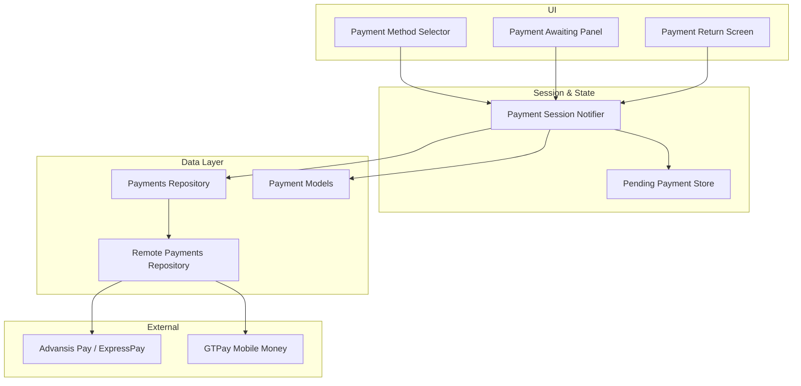
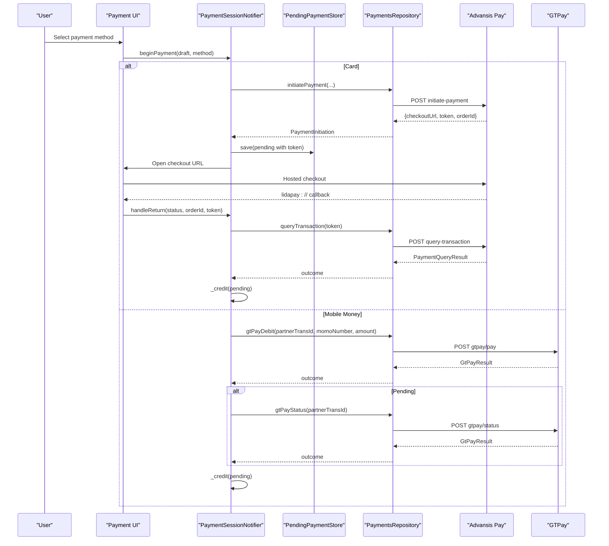
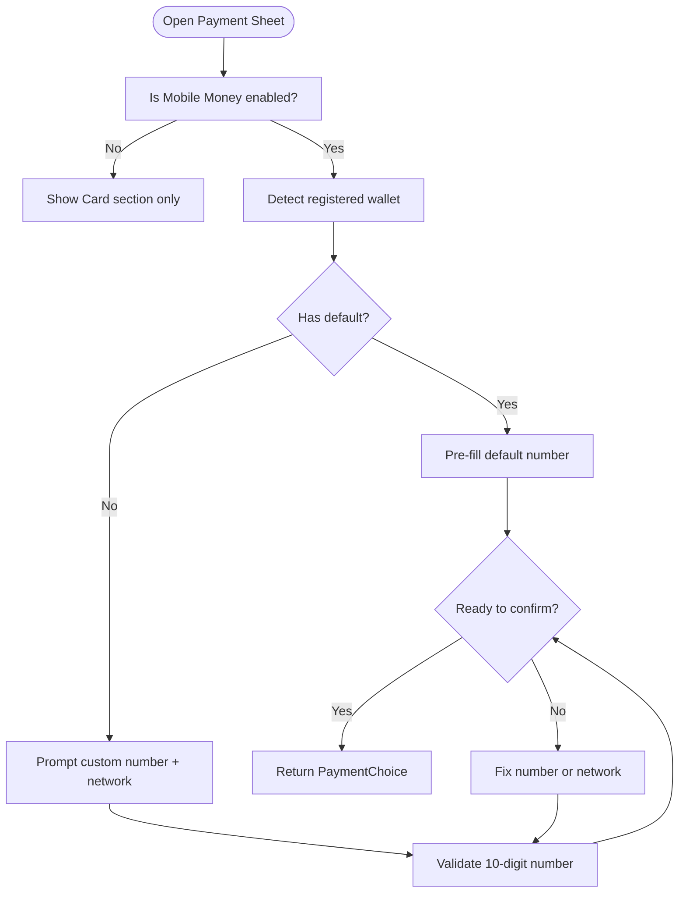
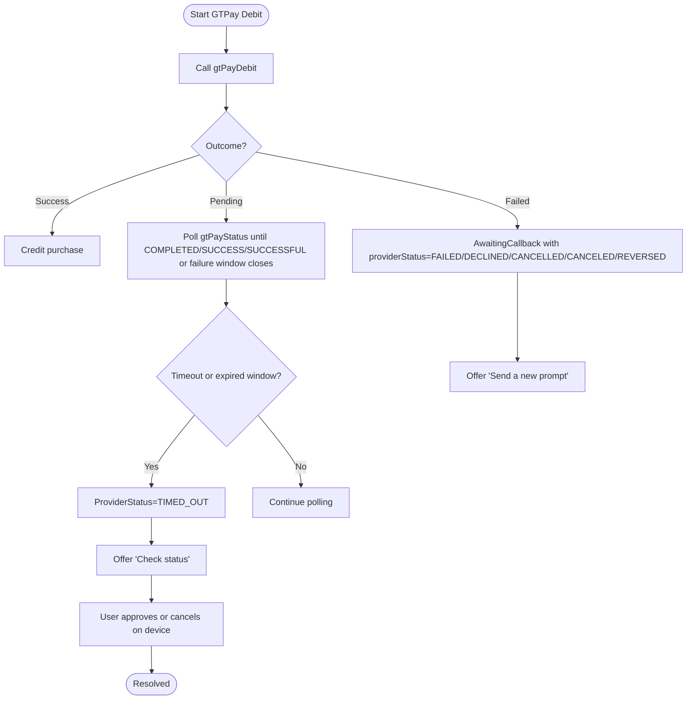
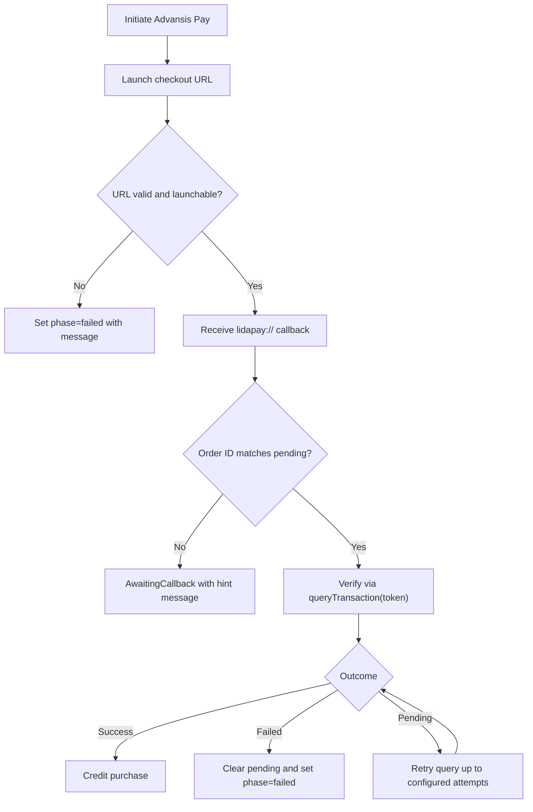
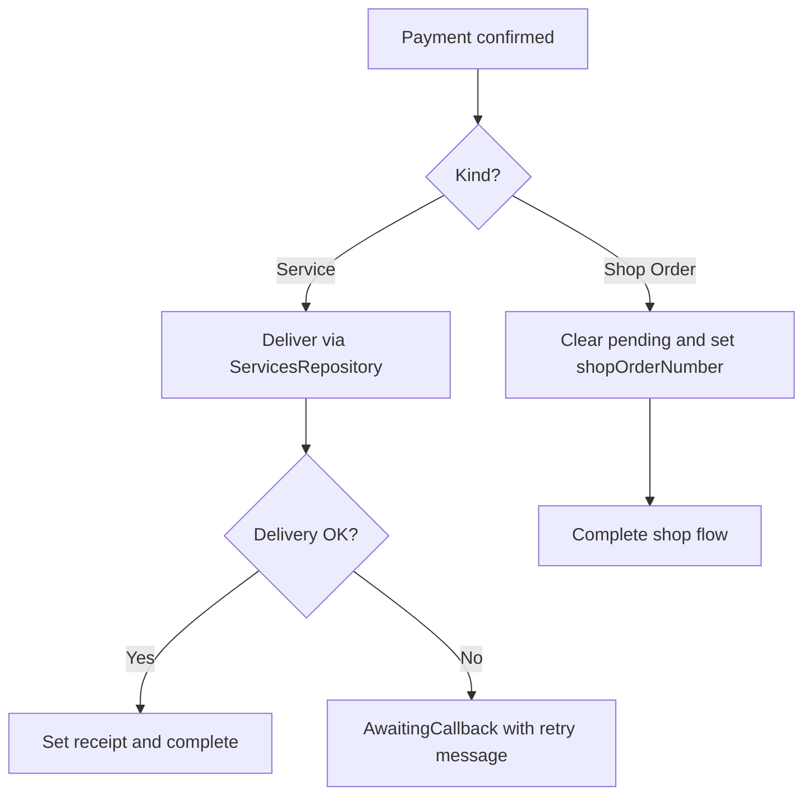
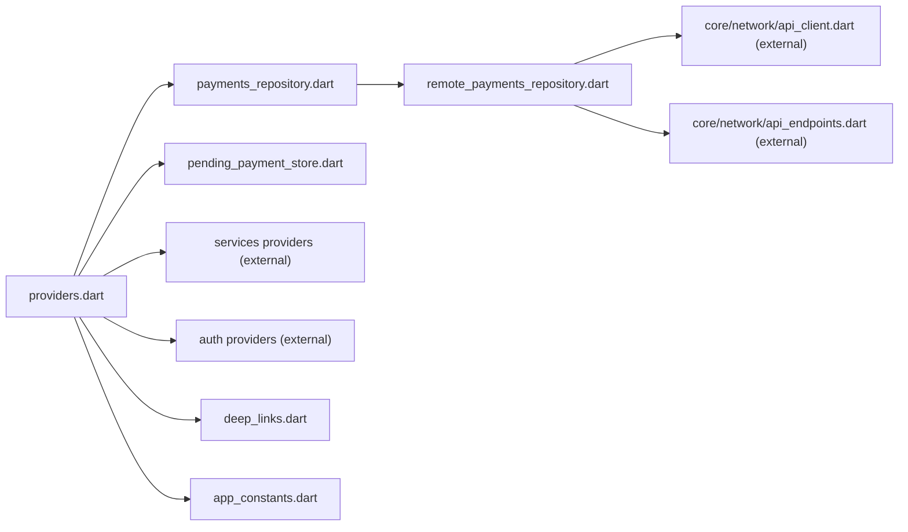

# Payment Processing Failures

<cite>
**Referenced Files in This Document**
- [README.md](file://README.md)
- [pubspec.yaml](file://pubspec.yaml)
- [payment_models.dart](file://lib/features/payments/data/payment_models.dart)
- [pending_payment.dart](file://lib/features/payments/data/pending_payment.dart)
- [pending_payment_store.dart](file://lib/features/payments/data/pending_payment_store.dart)
- [payments_repository.dart](file://lib/features/payments/data/payments_repository.dart)
- [remote_payments_repository.dart](file://lib/features/payments/data/remote_payments_repository.dart)
- [providers.dart](file://lib/features/payments/providers.dart)
- [payment_method_selector.dart](file://lib/features/payments/widgets/payment_method_selector.dart)
- [payment_awaiting_panel.dart](file://lib/features/payments/widgets/payment_awaiting_panel.dart)
- [payment_return_screen.dart](file://lib/features/payments/screens/payment_return_screen.dart)
- [deep_links.dart](file://lib/core/deep_links.dart)
- [app_constants.dart](file://lib/core/constants/app_constants.dart)
</cite>

## Table of Contents
1. [Introduction](#introduction)
2. [Project Structure](#project-structure)
3. [Core Components](#core-components)
4. [Architecture Overview](#architecture-overview)
5. [Detailed Component Analysis](#detailed-component-analysis)
6. [Dependency Analysis](#dependency-analysis)
7. [Performance Considerations](#performance-considerations)
8. [Troubleshooting Guide](#troubleshooting-guide)
9. [Conclusion](#conclusion)

## Introduction
This document provides comprehensive troubleshooting guidance for payment processing failures and financial transaction issues in the LidaPay Flutter application. It focuses on:
- Payment method selection problems
- Mobile money integration failures
- Card payment errors
- Wallet transaction issues
- Diagnostic procedures for payment status monitoring, pending payment resolution, and transaction reconciliation
- Payment gateway timeouts, insufficient balance scenarios, and payment method availability issues
- Solutions for payment confirmation delays, refund processing problems, and compliance-related payment restrictions

The guidance is grounded in the repository’s payment session orchestration, data models, persistence layer, UI flows, and deep-link handling.

## Project Structure
The payment system spans several modules:
- Data models define payment initiation, query results, mobile money results, and outcome classification.
- A repository abstraction and remote implementation call backend endpoints for card checkout and mobile money debit/status checks.
- A stateful payment session orchestrates initiation, verification, crediting, and completion.
- Persistent storage keeps an in-flight purchase record and sensitive fields securely.
- UI components guide users through method selection, awaiting approval, and return handling.
- Deep links route payment returns into the app.

**Diagram sources**
- [providers.dart:43-85](file://lib/features/payments/providers.dart#L43-L85)
- [remote_payments_repository.dart:7-109](file://lib/features/payments/data/remote_payments_repository.dart#L7-L109)
- [payment_method_selector.dart:21-46](file://lib/features/payments/widgets/payment_method_selector.dart#L21-L46)
- [payment_awaiting_panel.dart:15-15](file://lib/features/payments/widgets/payment_awaiting_panel.dart#L15-L15)
- [payment_return_screen.dart:22-25](file://lib/features/payments/screens/payment_return_screen.dart#L22-L25)

**Section sources**
- [README.md:1-47](file://README.md#L1-L47)
- [pubspec.yaml:1-152](file://pubspec.yaml#L1-L152)

## Core Components
- Payment models classify outcomes and parse provider responses consistently.
- Pending payment records persist across process death to support recovery.
- The payment session orchestrates the full lifecycle with idempotency safeguards.
- The repository abstracts network calls; the remote implementation enforces timeouts and error mapping.
- UI components provide user-facing diagnostics and actions.

Key responsibilities:
- Outcome classification: success, failed, pending.
- Token-driven verification for card payments.
- PartnerTransId-based reconciliation for mobile money.
- Secure storage of sensitive fields (token, MoMo number).
- Deep link routing for payment returns.

**Section sources**
- [payment_models.dart:8-49](file://lib/features/payments/data/payment_models.dart#L8-L49)
- [payment_models.dart:57-150](file://lib/features/payments/data/payment_models.dart#L57-L150)
- [payment_models.dart:165-214](file://lib/features/payments/data/payment_models.dart#L165-L214)
- [pending_payment.dart:24-87](file://lib/features/payments/data/pending_payment.dart#L24-L87)
- [pending_payment_store.dart:8-16](file://lib/features/payments/data/pending_payment_store.dart#L8-L16)
- [payments_repository.dart:3-45](file://lib/features/payments/data/payments_repository.dart#L3-L45)
- [remote_payments_repository.dart:12-53](file://lib/features/payments/data/remote_payments_repository.dart#L12-L53)
- [remote_payments_repository.dart:64-109](file://lib/features/payments/data/remote_payments_repository.dart#L64-L109)

## Architecture Overview
The payment flow has two rails:
- Card rail: initiate Advansis Pay checkout, open hosted page, verify via token polling, then credit.
- Mobile money rail: request GTPay debitwallet, poll status by PartnerTransId, reconcile even after timeouts or failures, then credit.

**Diagram sources**
- [providers.dart:182-277](file://lib/features/payments/providers.dart#L182-L277)
- [providers.dart:283-367](file://lib/features/payments/providers.dart#L283-L367)
- [providers.dart:372-421](file://lib/features/payments/providers.dart#L372-L421)
- [providers.dart:501-572](file://lib/features/payments/providers.dart#L501-L572)
- [providers.dart:578-665](file://lib/features/payments/providers.dart#L578-L665)
- [remote_payments_repository.dart:12-53](file://lib/features/payments/data/remote_payments_repository.dart#L12-L53)
- [remote_payments_repository.dart:64-109](file://lib/features/payments/data/remote_payments_repository.dart#L64-L109)

## Detailed Component Analysis

### Payment Method Selection Problems
Symptoms:
- Mobile money option hidden or disabled unexpectedly.
- Default wallet not detected or wrong network selected.
- Invalid MoMo number prevents proceeding.

Diagnostics:
- Confirm whether `showMobileMoney` is enabled when launching the sheet.
- Validate that the registered number matches supported prefixes.
- Ensure the active number is normalized and passes validation rules.

Resolution steps:
- If mobile money is intentionally disabled during GTBank production onboarding, switch to card.
- Use “Use default” to select the registered wallet.
- Enter a valid 10-digit Ghana MoMo number if using a custom wallet.
- Reopen the selector and reconfirm the chosen method.

**Diagram sources**
- [payment_method_selector.dart:21-46](file://lib/features/payments/widgets/payment_method_selector.dart#L21-L46)
- [payment_method_selector.dart:48-94](file://lib/features/payments/widgets/payment_method_selector.dart#L48-L94)
- [payment_method_selector.dart:113-190](file://lib/features/payments/widgets/payment_method_selector.dart#L113-L190)
- [payment_method_selector.dart:277-449](file://lib/features/payments/widgets/payment_method_selector.dart#L277-L449)

**Section sources**
- [payment_method_selector.dart:21-46](file://lib/features/payments/widgets/payment_method_selector.dart#L21-L46)
- [payment_method_selector.dart:48-94](file://lib/features/payments/widgets/payment_method_selector.dart#L48-L94)
- [payment_method_selector.dart:113-190](file://lib/features/payments/widgets/payment_method_selector.dart#L113-L190)
- [payment_method_selector.dart:277-449](file://lib/features/payments/widgets/payment_method_selector.dart#L277-L449)

### Mobile Money Integration Failures
Symptoms:
- Network reports failure or decline immediately.
- Status polling stops due to timeout.
- Approval prompt times out without confirmation.

Diagnostics:
- Inspect provider status values such as FAILED, DECLINED, CANCELLED, CANCELED, REVERSED, TIMED_OUT.
- Check whether the PartnerTransId was persisted before the pay call.
- Verify that the MoMo number is valid and normalized.

Resolution steps:
- For immediate failures, offer “Send a new prompt” to retry with a fresh PartnerTransId.
- For timeouts, instruct the user to check their phone’s MoMo approvals menu and tap “Check status”.
- If no response from the network, allow manual status check; avoid sending duplicate prompts until the previous attempt is cancelled.

**Diagram sources**
- [providers.dart:283-367](file://lib/features/payments/providers.dart#L283-L367)
- [providers.dart:578-665](file://lib/features/payments/providers.dart#L578-L665)
- [payment_awaiting_panel.dart:82-102](file://lib/features/payments/widgets/payment_awaiting_panel.dart#L82-L102)

**Section sources**
- [providers.dart:283-367](file://lib/features/payments/providers.dart#L283-L367)
- [providers.dart:578-665](file://lib/features/payments/providers.dart#L578-L665)
- [payment_awaiting_panel.dart:82-102](file://lib/features/payments/widgets/payment_awaiting_panel.dart#L82-L102)

### Card Payment Errors
Symptoms:
- Checkout page fails to open.
- Callback does not arrive or order ID mismatch occurs.
- Verification loop ends with failure or pending.

Diagnostics:
- Validate that the returned checkout URL is launchable.
- Confirm that the saved token exists and matches the pending record.
- Check query results for success/failure statuses and result text.

Resolution steps:
- If the checkout URL is invalid or cannot be launched, restart the payment flow.
- If the callback order ID does not match the pending record, wait and recheck.
- If verification fails after retries, clear the pending record and allow retry with another method.

**Diagram sources**
- [providers.dart:182-277](file://lib/features/payments/providers.dart#L182-L277)
- [providers.dart:372-421](file://lib/features/payments/providers.dart#L372-L421)
- [providers.dart:501-572](file://lib/features/payments/providers.dart#L501-L572)
- [payment_models.dart:57-150](file://lib/features/payments/data/payment_models.dart#L57-L150)

**Section sources**
- [providers.dart:182-277](file://lib/features/payments/providers.dart#L182-L277)
- [providers.dart:372-421](file://lib/features/payments/providers.dart#L372-L421)
- [providers.dart:501-572](file://lib/features/payments/providers.dart#L501-L572)
- [payment_models.dart:57-150](file://lib/features/payments/data/payment_models.dart#L57-L150)

### Wallet Transaction Issues
Symptoms:
- Purchase appears completed but delivery did not finish.
- Receipt missing; shop order number present instead.
- App resume shows verifying or crediting screens.

Diagnostics:
- Check whether the receipt is null and shop order number is set.
- Inspect pending payment kind and params for service vs shop orders.
- Review feed invalidation and last-order fallback logic.

Resolution steps:
- For service purchases, retry crediting via “I’ve paid”; the user will not be charged again.
- For shop orders, fetch the order by ID or number and display success screen.
- On app resume, ensure feeds are invalidated and receipts/orders resolved.

**Diagram sources**
- [providers.dart:700-754](file://lib/features/payments/providers.dart#L700-L754)
- [payment_return_screen.dart:118-204](file://lib/features/payments/screens/payment_return_screen.dart#L118-L204)

**Section sources**
- [providers.dart:700-754](file://lib/features/payments/providers.dart#L700-L754)
- [payment_return_screen.dart:118-204](file://lib/features/payments/screens/payment_return_screen.dart#L118-L204)

## Dependency Analysis
The payment subsystem depends on:
- Riverpod providers for repository, store, services, auth session, and checkout launcher.
- API client and endpoints for backend communication.
- Deep link handler for payment returns.
- Constants for allowed gateway domains and redirect URLs.

**Diagram sources**
- [providers.dart:24-41](file://lib/features/payments/providers.dart#L24-L41)
- [providers.dart:120-129](file://lib/features/payments/providers.dart#L120-L129)
- [remote_payments_repository.dart:1-5](file://lib/features/payments/data/remote_payments_repository.dart#L1-L5)
- [deep_links.dart:8-15](file://lib/core/deep_links.dart#L8-L15)
- [app_constants.dart:23-43](file://lib/core/constants/app_constants.dart#L23-L43)

**Section sources**
- [providers.dart:24-41](file://lib/features/payments/providers.dart#L24-L41)
- [providers.dart:120-129](file://lib/features/payments/providers.dart#L120-L129)
- [remote_payments_repository.dart:1-5](file://lib/features/payments/data/remote_payments_repository.dart#L1-L5)
- [deep_links.dart:8-15](file://lib/core/deep_links.dart#L8-L15)
- [app_constants.dart:23-43](file://lib/core/constants/app_constants.dart#L23-L43)

## Performance Considerations
- Query polling uses configurable attempts and delays to balance responsiveness and reliability.
- Mobile money polling respects an expiration window to avoid indefinite waiting.
- Single-flight verification prevents duplicate credits on duplicated callbacks or taps.
- Timeouts on mobile money status checks prevent hanging UI.

Recommendations:
- Tune `_queryAttempts`, `_queryDelay`, `_gtPayPollAttempts`, `_gtPayPollDelay`, and `_gtPayExpireAfter` based on backend SLAs and telco behavior.
- Monitor 5xx and timeout rates to adjust thresholds.
- Avoid excessive retries in high-latency networks; rely on manual “Check status” after expiration.

[No sources needed since this section provides general guidance]

## Troubleshooting Guide

### Common Payment Method Selection Problems
- Symptom: Mobile money rail hidden.
  - Cause: Production onboarding flag disables GTPay debitwallet.
  - Action: Switch to card or enable mobile money when available.
- Symptom: Wrong network detected.
  - Cause: Number prefix not matching known networks.
  - Action: Choose network manually and enter a valid 10-digit number.
- Symptom: Cannot proceed due to invalid number.
  - Cause: Number length or format invalid.
  - Action: Normalize to local 10-digit form and re-enter.

**Section sources**
- [payment_method_selector.dart:21-46](file://lib/features/payments/widgets/payment_method_selector.dart#L21-L46)
- [payment_method_selector.dart:48-94](file://lib/features/payments/widgets/payment_method_selector.dart#L48-L94)
- [payment_method_selector.dart:113-190](file://lib/features/payments/widgets/payment_method_selector.dart#L113-L190)

### Mobile Money Integration Failures
- Symptom: Immediate failure or decline.
  - Diagnostics: Provider status indicates FAILED/DECLINED/CANCELLED/CANCELED/REVERSED.
  - Resolution: Offer “Send a new prompt” to retry with a new PartnerTransId.
- Symptom: No response from network.
  - Diagnostics: Provider status TIMED_OUT or 504 timeout.
  - Resolution: Instruct user to check MoMo approvals; allow “Check status” once.
- Symptom: Prompt expired.
  - Diagnostics: Approval window closed while pending.
  - Resolution: Do not send a new prompt until cancellation; use “Check status”.

**Section sources**
- [providers.dart:283-367](file://lib/features/payments/providers.dart#L283-L367)
- [providers.dart:578-665](file://lib/features/payments/providers.dart#L578-L665)
- [payment_awaiting_panel.dart:82-102](file://lib/features/payments/widgets/payment_awaiting_panel.dart#L82-L102)

### Card Payment Errors
- Symptom: Checkout page not opening.
  - Diagnostics: Invalid or non-launchable checkout URL.
  - Resolution: Restart payment flow; ensure gateway domain is allowed.
- Symptom: Callback order ID mismatch.
  - Diagnostics: Returned orderId differs from saved advansisOrderId/orderNumber.
  - Resolution: Wait and recheck; do not force credit.
- Symptom: Verification fails after retries.
  - Diagnostics: PaymentOutcome.failed after polling.
  - Resolution: Clear pending; allow retry with another method.

**Section sources**
- [providers.dart:182-277](file://lib/features/payments/providers.dart#L182-L277)
- [providers.dart:372-421](file://lib/features/payments/providers.dart#L372-L421)
- [providers.dart:501-572](file://lib/features/payments/providers.dart#L501-L572)

### Wallet Transaction Issues
- Symptom: Payment confirmed but delivery incomplete.
  - Diagnostics: Phase remains awaitingCallback with retry message.
  - Resolution: Tap “I’ve paid” to retry crediting; user will not be charged again.
- Symptom: Missing receipt for shop order.
  - Diagnostics: Shop order number present; receipt null.
  - Resolution: Fetch order by ID or number; show success screen.

**Section sources**
- [providers.dart:700-754](file://lib/features/payments/providers.dart#L700-L754)
- [payment_return_screen.dart:118-204](file://lib/features/payments/screens/payment_return_screen.dart#L118-L204)

### Payment Status Monitoring and Pending Resolution
- Monitoring:
  - Use the awaiting panel to observe phases: initiating, awaitingCallback, verifying, crediting, completed, failed.
  - Provider status helps distinguish user-waiting states from network-reported failures.
- Pending resolution:
  - Persisted pending record survives process death; hydrate at startup.
  - Sensitive fields (token, MoMo number) stored securely; degrade gracefully if keystore unavailable.
  - Clear pending only after successful completion or explicit cancellation.

**Section sources**
- [payment_awaiting_panel.dart:15-15](file://lib/features/payments/widgets/payment_awaiting_panel.dart#L15-L15)
- [pending_payment_store.dart:8-16](file://lib/features/payments/data/pending_payment_store.dart#L8-L16)
- [pending_payment_store.dart:31-63](file://lib/features/payments/data/pending_payment_store.dart#L31-L63)
- [pending_payment_store.dart:65-121](file://lib/features/payments/data/pending_payment_store.dart#L65-L121)

### Transaction Reconciliation
- Card:
  - Authoritative check via token; ignore callback hints.
  - Multiple queries until success, failure, or max attempts.
- Mobile money:
  - Reconcile via PartnerTransId; never debit twice.
  - Treat timeouts and transient errors as unknown outcomes; continue reconciliation or prompt manual check.

**Section sources**
- [providers.dart:474-572](file://lib/features/payments/providers.dart#L474-L572)
- [providers.dart:578-665](file://lib/features/payments/providers.dart#L578-L665)
- [payment_models.dart:57-150](file://lib/features/payments/data/payment_models.dart#L57-L150)

### Payment Gateway Timeouts
- Symptom: Mobile money status check times out.
  - Diagnostics: 504 ApiException from gtPayStatus.
  - Resolution: Stop polling; let user check status manually.
- Symptom: Backend initiates checkout but cannot open URL.
  - Diagnostics: Non-launchable URL or launch failure.
  - Resolution: Restart flow; validate gateway domains.

**Section sources**
- [remote_payments_repository.dart:96-109](file://lib/features/payments/data/remote_payments_repository.dart#L96-L109)
- [providers.dart:235-253](file://lib/features/payments/providers.dart#L235-L253)

### Insufficient Balance Scenarios
- Symptom: Mobile money debit declines due to insufficient funds.
  - Diagnostics: Provider status indicates failure; message may include reason.
  - Resolution: Offer “Send a new prompt” after allowing user to top up; do not charge again.

**Section sources**
- [providers.dart:325-345](file://lib/features/payments/providers.dart#L325-L345)
- [providers.dart:626-638](file://lib/features/payments/providers.dart#L626-L638)

### Payment Method Availability Issues
- Symptom: Mobile money rail disabled.
  - Cause: GTBank production onboarding not complete.
  - Resolution: Use card rail; enable mobile money when available.

**Section sources**
- [payment_method_selector.dart:21-46](file://lib/features/payments/widgets/payment_method_selector.dart#L21-L46)

### Payment Confirmation Delays
- Symptom: Long delay between approval and completion.
  - Diagnostics: Verifying or crediting phase persists.
  - Resolution: Allow background reconciliation; user can tap “I’ve paid” to trigger a status check.

**Section sources**
- [providers.dart:501-572](file://lib/features/payments/providers.dart#L501-L572)
- [providers.dart:700-754](file://lib/features/payments/providers.dart#L700-L754)

### Refund Processing Problems
- Note: The codebase implements payment initiation, verification, and crediting; explicit refund endpoints are not present in the referenced files.
- Guidance:
  - If a refund is required, coordinate with backend and payment provider outside this flow.
  - Preserve transaction references (orderId, partnerTransId) for audit and reconciliation.

[No sources needed since this section summarizes without analyzing specific files]

### Compliance-Related Payment Restrictions
- Symptom: Payment blocked due to compliance or policy constraints.
  - Diagnostics: Backend returns error messages; deep link or callback may indicate cancellation.
  - Resolution: Present user-friendly failure message; allow switching methods or contacting support.

**Section sources**
- [providers.dart:372-421](file://lib/features/payments/providers.dart#L372-L421)
- [payment_return_screen.dart:206-228](file://lib/features/payments/screens/payment_return_screen.dart#L206-L228)

## Conclusion
The LidaPay payment system provides robust handling for both card and mobile money rails, with strong safeguards against double-charging, durable pending records, and clear user feedback for complex states. When troubleshooting:
- Identify the rail (card vs mobile money) and inspect provider-specific statuses.
- Use the awaiting panel and session state to diagnose where the flow stalled.
- Leverage token-based verification for cards and PartnerTransId reconciliation for mobile money.
- Apply targeted resolutions for timeouts, insufficient balances, method availability, and delivery failures.
- Coordinate refunds and compliance restrictions with backend and provider processes beyond the app flow.

[No sources needed since this section summarizes without analyzing specific files]