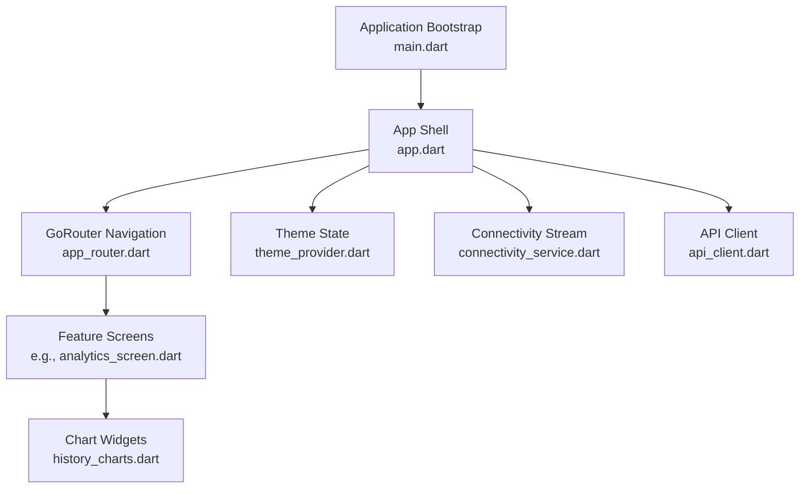
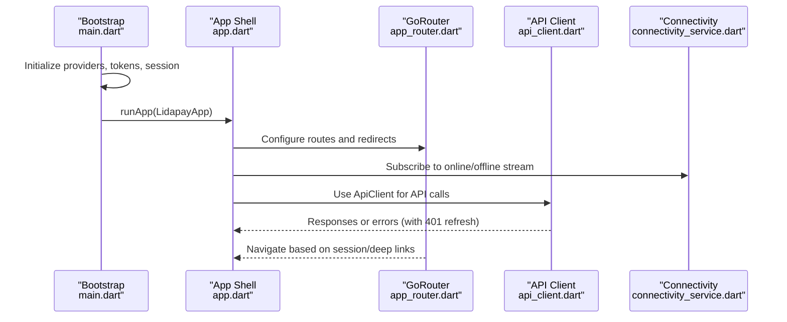
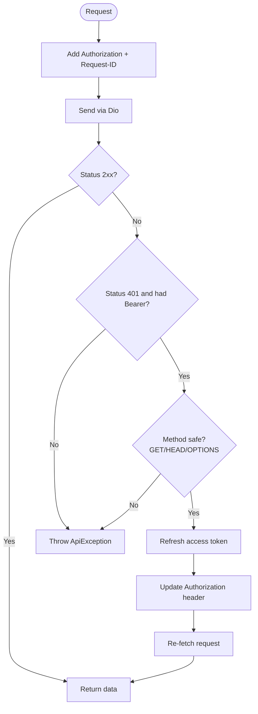
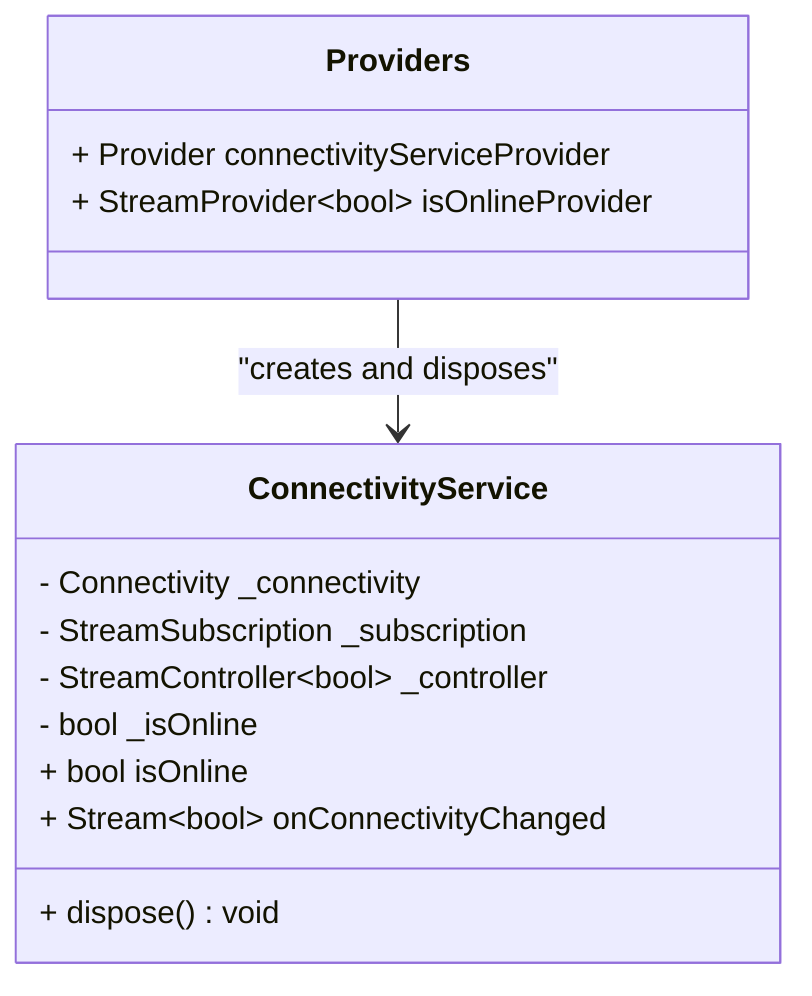
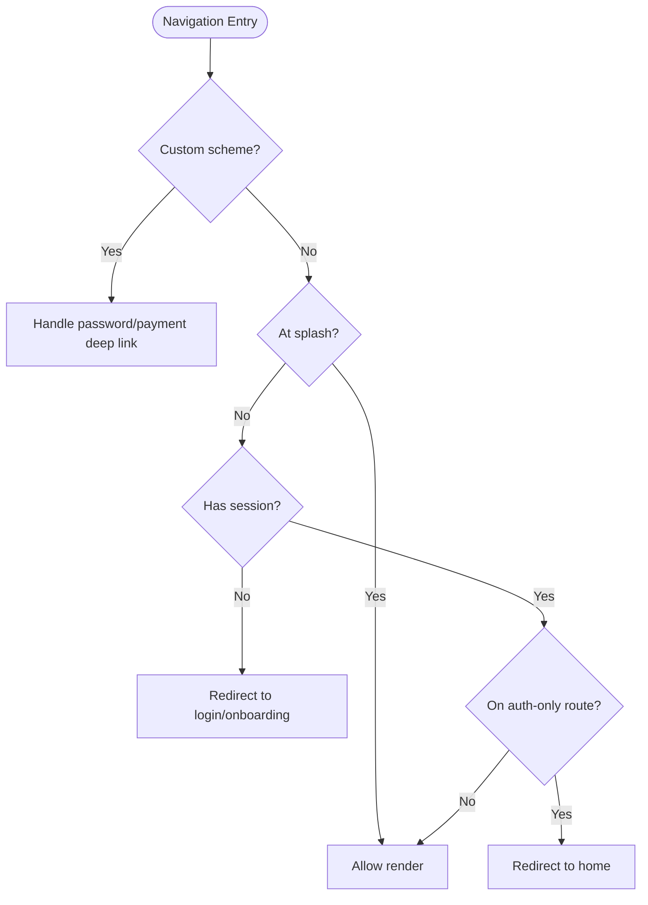
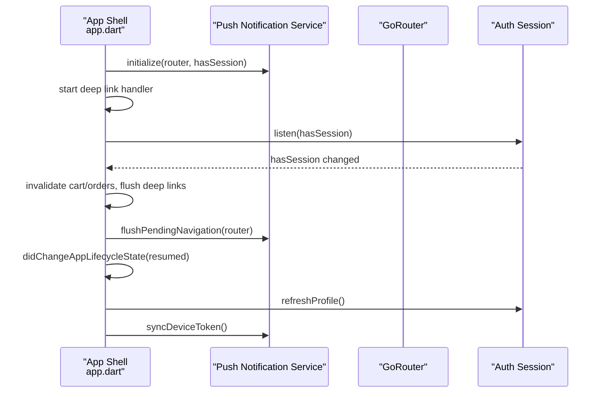
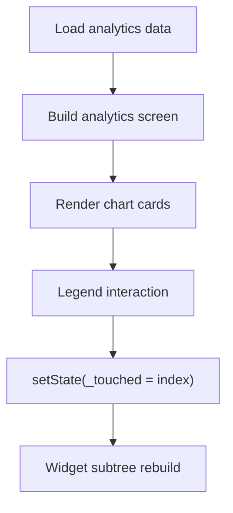
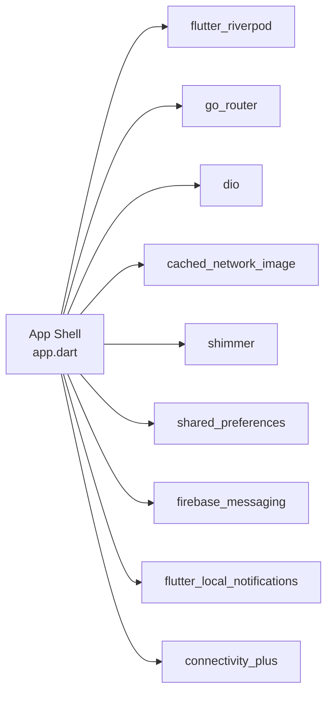

# Performance & Debugging Guide

<cite>
**Referenced Files in This Document**
- [main.dart](file://lib/main.dart)
- [app.dart](file://lib/app.dart)
- [pubspec.yaml](file://pubspec.yaml)
- [devtools_options.yaml](file://devtools_options.yaml)
- [api_client.dart](file://lib/core/network/api_client.dart)
- [connectivity_service.dart](file://lib/core/network/connectivity_service.dart)
- [app_router.dart](file://lib/core/router/app_router.dart)
- [theme_provider.dart](file://lib/core/providers/theme_provider.dart)
- [analytics_screen.dart](file://lib/features/history/screens/analytics_screen.dart)
- [history_charts.dart](file://lib/features/history/widgets/history_charts.dart)
</cite>

## Table of Contents
1. [Introduction](#introduction)
2. [Project Structure](#project-structure)
3. [Core Components](#core-components)
4. [Architecture Overview](#architecture-overview)
5. [Detailed Component Analysis](#detailed-component-analysis)
6. [Dependency Analysis](#dependency-analysis)
7. [Performance Considerations](#performance-considerations)
8. [Troubleshooting Guide](#troubleshooting-guide)
9. [Conclusion](#conclusion)

## Introduction
This guide explains how to profile and debug the LidaPay Flutter application for memory leaks, CPU bottlenecks, UI rendering issues, slow API responses, large image loading problems, database query optimization, state management inefficiencies, navigation performance, and background task execution. It maps these techniques directly to the app’s entry point, routing, network layer, connectivity handling, and feature screens.

## Project Structure
LidaPay is a Flutter application with:
- A guarded application bootstrap that initializes providers, secure storage, token store, device identity, session restoration, and error boundaries.
- An app shell that wires theme, router, push notifications, deep links, and offline awareness.
- A centralized Dio-based API client with token injection, request tracing, and automatic 401 refresh.
- GoRouter-based navigation with root-level overlays for payment callbacks and recipient decisions.
- Feature modules for authentication, dashboard, history, services, shop, payments, and more.

**Diagram sources**
- [main.dart:17-149](file://lib/main.dart#L17-L149)
- [app.dart:56-262](file://lib/app.dart#L56-L262)
- [app_router.dart:94-411](file://lib/core/router/app_router.dart#L94-L411)
- [theme_provider.dart:6-38](file://lib/core/providers/theme_provider.dart#L6-L38)
- [connectivity_service.dart:5-45](file://lib/core/network/connectivity_service.dart#L5-L45)
- [api_client.dart:16-275](file://lib/core/network/api_client.dart#L16-L275)
- [analytics_screen.dart:70-109](file://lib/features/history/screens/analytics_screen.dart#L70-L109)
- [history_charts.dart:242-277](file://lib/features/history/widgets/history_charts.dart#L242-L277)

**Section sources**
- [main.dart:17-149](file://lib/main.dart#L17-L149)
- [app.dart:56-262](file://lib/app.dart#L56-L262)
- [pubspec.yaml:30-76](file://pubspec.yaml#L30-L76)

## Core Components
- Application bootstrap: Initializes Flutter bindings, edge-to-edge mode, global error handlers, provider container, secure storage, token store, device identity, pending payment hydration, and session restore with bounded timeouts.
- App shell: Configures Material app, scroll behavior, theme, router, push notifications, deep links, lifecycle-aware profile refresh, and offline banner.
- API client: Centralized Dio client with bearer token injection, request ID, debug logging, redaction of sensitive fields, timeout configuration, and single-flight 401 token refresh with retry on safe methods.
- Connectivity service: Streams online/offline state using connectivity_plus.
- Router: GoRouter with auth guards, deep link handling, root navigator for overlay routes, and indexed stack shells.
- Theme provider: Persisted theme mode selection via shared_preferences.

**Section sources**
- [main.dart:17-149](file://lib/main.dart#L17-L149)
- [app.dart:56-262](file://lib/app.dart#L56-L262)
- [api_client.dart:16-275](file://lib/core/network/api_client.dart#L16-L275)
- [connectivity_service.dart:5-45](file://lib/core/network/connectivity_service.dart#L5-L45)
- [app_router.dart:94-411](file://lib/core/router/app_router.dart#L94-L411)
- [theme_provider.dart:6-38](file://lib/core/providers/theme_provider.dart#L6-L38)

## Architecture Overview
The runtime flow starts at main, sets up error boundaries and providers, hydrates critical state, then runs the app shell which configures navigation, theme, connectivity, and background tasks. The API client intercepts requests, injects tokens, logs diagnostics in debug builds, and transparently refreshes access tokens on 401.

**Diagram sources**
- [main.dart:17-149](file://lib/main.dart#L17-L149)
- [app.dart:56-262](file://lib/app.dart#L56-L262)
- [app_router.dart:94-411](file://lib/core/router/app_router.dart#L94-L411)
- [api_client.dart:16-275](file://lib/core/network/api_client.dart#L16-L275)
- [connectivity_service.dart:5-45](file://lib/core/network/connectivity_service.dart#L5-L45)

## Detailed Component Analysis

### API Client: Token Injection, Logging, and 401 Refresh
The API client centralizes HTTP behavior:
- Adds Authorization headers when available.
- Injects a unique request ID per request.
- Logs method, URI, and redacted body/status in debug builds.
- On 401, performs a single-flight token refresh and retries GET/HEAD/OPTIONS once.
- Uses separate Dio instances for normal and refresh calls.
- Maps Dio exceptions to domain-specific API exceptions.

**Diagram sources**
- [api_client.dart:25-83](file://lib/core/network/api_client.dart#L25-L83)
- [api_client.dart:125-135](file://lib/core/network/api_client.dart#L125-L135)
- [api_client.dart:195-202](file://lib/core/network/api_client.dart#L195-L202)
- [api_client.dart:204-265](file://lib/core/network/api_client.dart#L204-L265)

**Section sources**
- [api_client.dart:16-275](file://lib/core/network/api_client.dart#L16-L275)

### Connectivity Service: Online/Offline Awareness
Streams connectivity changes and exposes a broadcast boolean stream used by the app shell to show an offline banner and gate certain behaviors.

**Diagram sources**
- [connectivity_service.dart:5-45](file://lib/core/network/connectivity_service.dart#L5-L45)

**Section sources**
- [connectivity_service.dart:5-45](file://lib/core/network/connectivity_service.dart#L5-L45)

### Router: Auth Guards, Deep Links, and Root Overlays
GoRouter manages:
- Initial splash and onboarding.
- Auth route guards and redirect logic.
- Password reset and verification flows.
- Payment callback and recipient decision routes mounted on the root navigator.
- Indexed stack shells for Home, Services, Shop, History, Profile.

**Diagram sources**
- [app_router.dart:108-164](file://lib/core/router/app_router.dart#L108-L164)
- [app_router.dart:166-411](file://lib/core/router/app_router.dart#L166-L411)

**Section sources**
- [app_router.dart:94-411](file://lib/core/router/app_router.dart#L94-L411)

### App Shell: Lifecycle, Notifications, and Offline Banner
The app shell:
- Initializes push notifications and deep links.
- Listens for session changes to invalidate cart/orders and flush parked deep links.
- On resume, refreshes profile, syncs device token, and refreshes pending recipient decisions.
- Applies edge-to-edge system UI and dynamic status/navigation bar styles.
- Wraps content with keyboard dismissal and shows a non-blocking offline banner.

**Diagram sources**
- [app.dart:70-128](file://lib/app.dart#L70-L128)
- [app.dart:139-257](file://lib/app.dart#L139-L257)

**Section sources**
- [app.dart:56-262](file://lib/app.dart#L56-L262)

### Analytics Screen and Charts: Potential Rebuild Hotspots
The analytics screen composes multiple chart cards and uses setState for local tab selection. Chart widgets use AnimatedContainer and GestureDetector for interactive legends. These patterns can cause frequent rebuilds if parent widgets rebuild often.

**Diagram sources**
- [analytics_screen.dart:70-109](file://lib/features/history/screens/analytics_screen.dart#L70-L109)
- [history_charts.dart:242-277](file://lib/features/history/widgets/history_charts.dart#L242-L277)

**Section sources**
- [analytics_screen.dart:70-109](file://lib/features/history/screens/analytics_screen.dart#L70-L109)
- [history_charts.dart:242-277](file://lib/features/history/widgets/history_charts.dart#L242-L277)

### Theme Provider: Persisted Mode Selection
A simple StateNotifier backed by shared_preferences persists user-selected theme mode. Avoid unnecessary writes by batching updates and avoiding redundant persistence calls.

**Section sources**
- [theme_provider.dart:6-38](file://lib/core/providers/theme_provider.dart#L6-L38)

## Dependency Analysis
Key runtime dependencies include:
- flutter_riverpod for state management.
- go_router for navigation.
- dio for networking.
- cached_network_image and shimmer for image loading and placeholders.
- shared_preferences for lightweight persistence.
- firebase_messaging and flutter_local_notifications for push/local notifications.
- connectivity_plus for network reachability.

**Diagram sources**
- [pubspec.yaml:30-76](file://pubspec.yaml#L30-L76)
- [app.dart:56-262](file://lib/app.dart#L56-L262)

**Section sources**
- [pubspec.yaml:30-76](file://pubspec.yaml#L30-L76)

## Performance Considerations

### Identifying Memory Leaks
- Use Flutter DevTools Memory view to capture heap snapshots before and after key flows (login, long lists, charts). Look for retained objects from streams, subscriptions, timers, and platform channels.
- Ensure all StreamSubscription and periodic tasks are disposed. The connectivity service disposes its subscription and controller; verify similar patterns across features.
- Avoid retaining large models in widget state; prefer Riverpod providers scoped to feature lifetimes.
- Watch for closures capturing heavy objects unintentionally in listeners.

### Identifying CPU Bottlenecks
- Use the Performance view in DevTools to record frames during interactions like scrolling charts, navigating between tabs, and opening payment flows.
- Identify expensive build phases, layout passes, and rasterization. In chart-heavy screens, avoid rebuilding entire subtrees on small interactions.
- Prefer const constructors where possible and split large widgets into smaller, memoized components.

### Identifying UI Rendering Issues
- Enable the Performance Overlay to monitor frame times, build counts, and repaint boundaries.
- Use RepaintBoundary around heavy widgets such as charts and images to isolate repaint costs.
- Minimize AnimatedWidget usage inside frequently rebuilt subtrees; animate only necessary properties.

### Using Flutter DevTools and Performance Overlays
- Open DevTools from the IDE or command line while running the app.
- Record a timeline during typical user flows to correlate UI jank with network calls or state updates.
- Enable the Performance Overlay in debug builds to visualize frame budgets and repaint regions.

### Logging Strategies
- The API client logs requests, responses, and errors in debug builds with sensitive field redaction. Keep this enabled during profiling but disable in release builds.
- The bootstrap disables debugPrint in release builds to prevent log leakage.
- Introduce structured logging for feature events (navigation, API calls, user actions) to correlate with DevTools traces.

### Common Anti-Patterns and Fixes
- Excessive widget rebuilds:
  - Replace broad Consumer/ConsumerWidget usage with selective ref.watch/ref.listenManual.
  - Split large screens into smaller widgets and use const where possible.
- Inefficient list rendering:
  - Use ListView.builder with stable keys and avoid rebuilding list items unnecessarily.
- Large image loading:
  - Use cached_network_image with appropriate cache policies and placeholder widgets.
  - Pre-size images and avoid decoding oversized assets.
- Excessive network requests:
  - Deduplicate concurrent requests using provider state or request caching.
  - Debounce search inputs and throttle repeated fetches.

### Slow API Responses
- Tune Dio timeouts: connectTimeout/sendTimeout vs receiveTimeout. The client already separates fast connect timeouts from longer receive timeouts.
- Implement pagination and server-side filtering for large datasets.
- Cache read-only endpoints locally when appropriate.
- Use optimistic UI updates with rollback on failure.

### Database Query Optimization
- If using a local database (e.g., sqflite, drift), ensure proper indexing on queried columns.
- Batch writes and avoid transactions within hot paths.
- Stream results incrementally rather than loading full tables into memory.

### State Management Problems
- Avoid reading global state in deeply nested widgets unless necessary; lift state closer to consumers.
- Use ref.listenManual for side effects instead of triggering rebuilds.
- Invalidate providers explicitly when related data changes to keep caches consistent.

### Navigation Performance
- Keep route builders lightweight; defer heavy initialization until the route is visible.
- Avoid recreating the router on auth changes; the app uses refreshListenable to re-evaluate redirects without rebuilding the Navigator.
- Use root navigator for modal-like overlays to avoid stacking issues.

### Background Task Execution
- Ensure background message handlers and periodic tasks are resilient and do not block the UI thread.
- Use Isolate for heavy computations and communicate via messages.
- Respect app lifecycle: pause/resume tasks appropriately.

## Troubleshooting Guide

### Startup Freezes or Long Cold Starts
Symptoms:
- Splash freezes while restoring sessions or hydrating pending payments.

Checks:
- Verify timeouts around session restore and pending payment hydration.
- Ensure token store and secure storage operations are fast and fail gracefully.

Actions:
- Move non-critical initialization off the critical path.
- Profile startup with DevTools Timeline to identify blocking operations.

**Section sources**
- [main.dart:122-141](file://lib/main.dart#L122-L141)

### Unexpected Red Screen of Death
Symptoms:
- UI crashes due to layout bugs or unhandled exceptions.

Checks:
- Global FlutterError and PlatformDispatcher.onError handlers are active.
- ErrorWidget builder provides a recovery action.

Actions:
- Use the “Refresh Screen” action to recover.
- Inspect captured error logs and stack traces.

**Section sources**
- [main.dart:30-40](file://lib/main.dart#L30-L40)
- [main.dart:44-96](file://lib/main.dart#L44-L96)

### Authentication Loops or Stuck Routes
Symptoms:
- User bounces between login and home, or payment callbacks navigate incorrectly.

Checks:
- Router redirect logic handles custom schemes, password links, and payment returns.
- Session state is refreshed before redirect decisions.

Actions:
- Validate deep link parsing and session restoration timing.
- Ensure payment callback routes are not redirected to splash.

**Section sources**
- [app_router.dart:108-164](file://lib/core/router/app_router.dart#L108-L164)
- [app_router.dart:221-237](file://lib/core/router/app_router.dart#L221-L237)

### 401 Loops or Failed Retries
Symptoms:
- Requests repeatedly fail after token refresh.

Checks:
- Single-flight refresh implementation and safe-method retry policy.
- Token store clear on invalid refresh responses.

Actions:
- Clear biometric/session state when refresh fails with explicit rejection codes.
- Log redacted payloads to diagnose payload mismatches.

**Section sources**
- [api_client.dart:50-83](file://lib/core/network/api_client.dart#L50-L83)
- [api_client.dart:204-265](file://lib/core/network/api_client.dart#L204-L265)

### Offline Banner Not Showing or Always Showing
Symptoms:
- Offline banner missing or persistent despite connectivity.

Checks:
- Connectivity stream emits correct online/offline transitions.
- App shell reads isOnlineProvider and wraps content accordingly.

Actions:
- Verify initial connectivity check and stream subscription disposal.
- Ensure no provider overrides mask the online state.

**Section sources**
- [connectivity_service.dart:11-45](file://lib/core/network/connectivity_service.dart#L11-L45)
- [app.dart:139-257](file://lib/app.dart#L139-L257)

### Chart Jank or Laggy Interactions
Symptoms:
- Toggling chart legends causes stutter.

Checks:
- setState usage and AnimatedContainer animations in chart widgets.
- Parent widget rebuild frequency.

Actions:
- Scope setState to minimal subtrees.
- Use RepaintBoundary around chart areas.
- Defer heavy calculations off the UI thread.

**Section sources**
- [analytics_screen.dart:70-109](file://lib/features/history/screens/analytics_screen.dart#L70-L109)
- [history_charts.dart:242-277](file://lib/features/history/widgets/history_charts.dart#L242-L277)

### DevTools Configuration
- The devtools_options.yaml file exists for Dart and Flutter DevTools extension settings. Ensure extensions are enabled as needed for profiling.

**Section sources**
- [devtools_options.yaml:1-4](file://devtools_options.yaml#L1-L4)

## Conclusion
By combining Flutter DevTools, performance overlays, structured logging, and targeted code analysis, you can efficiently locate and resolve memory leaks, CPU bottlenecks, and UI rendering issues in LidaPay. Focus on minimizing rebuilds, optimizing network calls, caching images, and ensuring robust state and navigation flows. The app’s architecture already includes several performance-conscious patterns; extend them consistently across features for a smooth, responsive user experience.