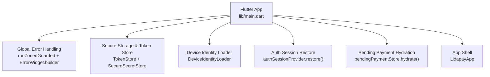
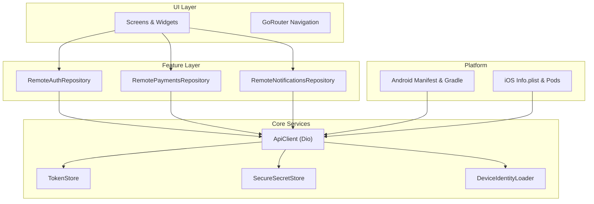
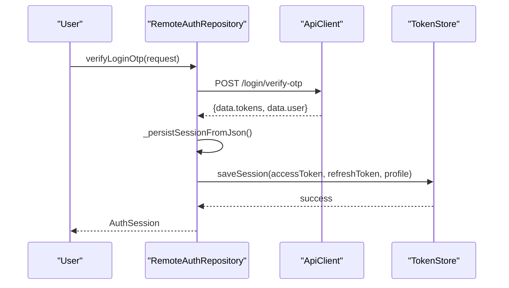
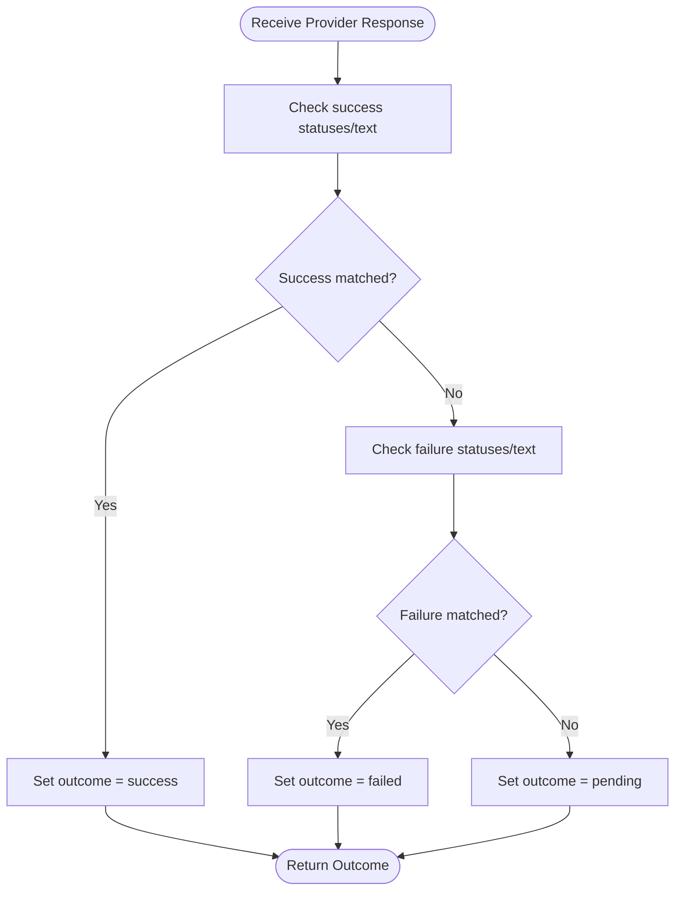
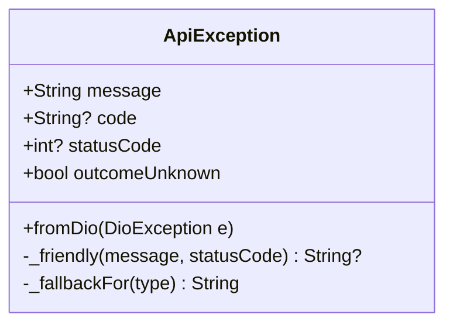

# Troubleshooting & FAQ

<cite>
**Referenced Files in This Document**
- [README.md](file://README.md)
- [pubspec.yaml](file://pubspec.yaml)
- [main.dart](file://lib/main.dart)
- [api_exception.dart](file://lib/core/network/api_exception.dart)
- [remote_auth_repository.dart](file://lib/features/auth/data/remote_auth_repository.dart)
- [payment_models.dart](file://lib/features/payments/data/payment_models.dart)
- [pending_payment.dart](file://lib/features/payments/data/pending_payment.dart)
- [payment_flow_test.dart](file://test/payment_flow_test.dart)
- [location_service.dart](file://lib/core/location/location_service.dart)
- [AndroidManifest.xml](file://android/app/src/main/AndroidManifest.xml)
- [Info.plist](file://ios/Runner/Info.plist)
- [build.gradle.kts](file://android/app/build.gradle.kts)
- [gradle.properties](file://android/gradle.properties)
- [settings.gradle.kts](file://android/settings.gradle.kts)
</cite>

## Table of Contents
1. Introduction
2. Project Structure
3. Core Components
4. Architecture Overview
5. Detailed Component Analysis
6. Dependency Analysis
7. Performance Considerations
8. Troubleshooting Guide
9. Conclusion
10. Appendices

## Introduction
This document provides troubleshooting and frequently asked questions for the LidaPay Flutter application. It focuses on common errors, root causes, step-by-step resolutions, debugging techniques for network and authentication issues, payment failures, platform-specific bugs, diagnostic commands, log analysis, performance profiling guidance, development environment problems, dependency conflicts, build issues, architecture decisions, feature limitations, and migration procedures.

## Project Structure
LidaPay is a Flutter mobile app with Android and iOS platforms. The Dart entry point initializes global error handling, secure storage, token persistence, device identity, and session restoration before launching the app. Platform configurations include Android manifest permissions and URL schemes, iOS Info.plist settings, and Gradle build configuration for signing and Google Maps API key injection.

**Diagram sources**
- [main.dart:17-149](file://lib/main.dart#L17-L149)

**Section sources**
- [README.md:1-47](file://README.md#L1-L47)
- [pubspec.yaml:1-151](file://pubspec.yaml#L1-L151)
- [main.dart:17-149](file://lib/main.dart#L17-L149)

## Core Components
- Global error handling prevents red screens and captures framework/platform errors.
- Secure secret store and token store manage encrypted credentials and session state.
- Device identity loader provides stable identifiers for diagnostics.
- Auth session restore loads persisted sessions at startup with bounded timeouts.
- Pending payment hydration restores in-flight purchase data before checkout.

Key responsibilities:
- Network errors are normalized into user-friendly messages via ApiException.
- Authentication persists tokens and user profile after login or OTP verification.
- Payment outcomes are derived from provider responses to determine success/failure/pending states.
- Location service returns null when location services or permissions are unavailable.

**Section sources**
- [main.dart:17-149](file://lib/main.dart#L17-L149)
- [api_exception.dart:1-79](file://lib/core/network/api_exception.dart#L1-L79)
- [remote_auth_repository.dart:42-80](file://lib/features/auth/data/remote_auth_repository.dart#L42-L80)
- [payment_models.dart:128-163](file://lib/features/payments/data/payment_models.dart#L128-L163)
- [location_service.dart:41-70](file://lib/core/location/location_service.dart#L41-L70)

## Architecture Overview
The app follows a layered approach:
- UI layer uses Riverpod providers and GoRouter navigation.
- Feature repositories interact with ApiClient (Dio-based HTTP client).
- Data models normalize backend payloads and compute derived states (e.g., payment outcome).
- Platform integrations handle push notifications, maps, and deep links.

**Diagram sources**
- [main.dart:17-149](file://lib/main.dart#L17-L149)
- [remote_auth_repository.dart:42-80](file://lib/features/auth/data/remote_auth_repository.dart#L42-L80)
- [AndroidManifest.xml:1-101](file://android/app/src/main/AndroidManifest.xml#L1-L101)
- [Info.plist:1-95](file://ios/Runner/Info.plist#L1-L95)

## Detailed Component Analysis

### Authentication Flow and Errors
Authentication involves login and OTP verification, persisting tokens and user profile, and handling refresh failures by clearing the session.

Common issues and resolutions:
- Empty access token after OTP verification: repository throws an ApiException indicating sign-in failed; ensure backend returns valid tokens and user payload.
- Refresh failure clears session: if refresh endpoint returns 401 Unauthorized, stored session is removed; re-authenticate the user.

**Diagram sources**
- [remote_auth_repository.dart:42-80](file://lib/features/auth/data/remote_auth_repository.dart#L42-L80)

**Section sources**
- [remote_auth_repository.dart:42-80](file://lib/features/auth/data/remote_auth_repository.dart#L42-L80)

### Payment Outcome Determination
Payment outcomes are computed from provider response fields such as status, resultText, originalResultText, and originalResult.

Common issues and resolutions:
- Ambiguous provider responses may lead to pending outcomes; inspect raw fields and update mapping logic if provider semantics change.
- Ensure correct fields are sent during initiation (shopOrderNumber, payTransRef) and avoid sending returnUrl or redirectUrl.

**Diagram sources**
- [payment_models.dart:128-163](file://lib/features/payments/data/payment_models.dart#L128-L163)

**Section sources**
- [payment_models.dart:128-163](file://lib/features/payments/data/payment_models.dart#L128-L163)
- [payment_flow_test.dart:292-316](file://test/payment_flow_test.dart#L292-L316)

### Pending Payment Persistence
Pending payments are persisted to allow recovery if users return to checkout before completing payment. Fields include kind, reference, clientReference, amounts, currencies, order description, parameters, timestamps, tokens, partner IDs, checkout URLs, method, partner transaction ID, and MoMo number.

Common issues and resolutions:
- If checkout cannot resume, verify that all required fields are present and correctly serialized/deserialized.
- Ensure hydrate completes within timeout to avoid blocking startup.

**Section sources**
- [pending_payment.dart:66-302](file://lib/features/payments/data/pending_payment.dart#L66-L302)

### Network Error Normalization
ApiException translates Dio exceptions into friendly messages and marks requests without server responses as outcomeUnknown to prevent unsafe retries.

Common issues and resolutions:
- Backend leaks internal details; friendly mapping hides internals and shows actionable messages.
- Network timeouts and connection errors produce specific user-facing messages; guide users to check connectivity.

**Diagram sources**
- [api_exception.dart:1-79](file://lib/core/network/api_exception.dart#L1-L79)

**Section sources**
- [api_exception.dart:1-79](file://lib/core/network/api_exception.dart#L1-L79)

### Location Service Behavior
Location retrieval gracefully handles disabled services, denied permissions, and offline conditions by returning null.

Common issues and resolutions:
- If getCurrentLocation returns null, check device location services and permission prompts.
- Use fallback coordinates for demo or degraded UX when location is unavailable.

**Section sources**
- [location_service.dart:41-70](file://lib/core/location/location_service.dart#L41-L70)

## Dependency Analysis
Key dependencies and their roles:
- flutter_riverpod: state management across features.
- go_router: declarative routing and deep link handling.
- dio: HTTP client used by ApiClient for API calls.
- shared_preferences and flutter_secure_storage: local storage and secure secrets.
- firebase_core and firebase_messaging: push notifications and FCM integration.
- geolocator and geocoding: location acquisition and reverse geocoding.
- google_maps_flutter: map rendering and location features.

Build-time considerations:
- Android Gradle properties tune JVM memory and Kotlin daemon heap to avoid OOM during builds.
- Android manifest declares internet, network state, notifications, biometric, and location permissions.
- iOS Info.plist configures URL schemes, background modes, and usage descriptions.

**Section sources**
- [pubspec.yaml:1-151](file://pubspec.yaml#L1-L151)
- [gradle.properties:1-10](file://android/gradle.properties#L1-L10)
- [AndroidManifest.xml:1-101](file://android/app/src/main/AndroidManifest.xml#L1-L101)
- [Info.plist:1-95](file://ios/Runner/Info.plist#L1-L95)

## Performance Considerations
- Startup timeouts: auth session restore and pending payment hydration use bounded timeouts to prevent splash freezes.
- Release logging: debugPrint is suppressed in release builds to avoid leaking sensitive diagnostics.
- Proguard/R8: minification and resource shrinking reduce bundle size; symbol tables enable deobfuscation of native crashes.
- Memory tuning: Gradle JVM args and Kotlin daemon heap sizes help avoid OOM during large builds.

Recommendations:
- Profile cold start using DevTools and monitor initialization steps.
- Avoid heavy synchronous work in main(); keep only essential setup.
- Use network caching strategies where appropriate to reduce latency.

**Section sources**
- [main.dart:24-40](file://lib/main.dart#L24-L40)
- [main.dart:122-141](file://lib/main.dart#L122-L141)
- [build.gradle.kts:66-83](file://android/app/build.gradle.kts#L66-L83)
- [gradle.properties:1-10](file://android/gradle.properties#L1-L10)

## Troubleshooting Guide

### Network Issues
Symptoms:
- Timeouts, connection errors, or “offline” messages.
- Intermittent failures during payment initiation or OTP verification.

Root causes:
- Poor connectivity, DNS issues, or backend outages.
- Non-idempotent operations attempted without considering outcomeUnknown.

Resolution steps:
- Verify device connectivity and try again.
- Inspect ApiException messages and statusCode to distinguish timeouts vs. server errors.
- For non-idempotent writes, do not retry blindly when outcomeUnknown is true.

Diagnostic commands:
- flutter analyze and flutter test to validate code and tests.
- On Android: adb logcat | grep -iE "dio|api|error" to capture network-related logs.
- On iOS: xcodebuild logs or Console.app filtering for Firebase/Dio errors.

**Section sources**
- [api_exception.dart:40-74](file://lib/core/network/api_exception.dart#L40-L74)

### Authentication Problems
Symptoms:
- Sign-in fails after OTP verification.
- Session cleared unexpectedly.

Root causes:
- Missing or empty access token in backend response.
- Refresh endpoint returns 401 Unauthorized, triggering session cleanup.

Resolution steps:
- Confirm backend returns valid tokens and user payload.
- Re-authenticate if session was cleared due to refresh failure.
- Validate JWT claims and userId extraction logic.

Diagnostic commands:
- Enable verbose logging in debug builds and review repository logs.
- Inspect token store contents securely in dev environments.

**Section sources**
- [remote_auth_repository.dart:42-80](file://lib/features/auth/data/remote_auth_repository.dart#L42-L80)

### Payment Failures
Symptoms:
- Payment outcome remains pending or flips unexpectedly.
- Checkout does not resume after returning to the app.

Root causes:
- Ambiguous provider response fields.
- Missing or incorrect request fields (shopOrderNumber, payTransRef).
- Pending payment hydration timeout or incomplete serialization.

Resolution steps:
- Review provider response mapping and adjust outcome determination if needed.
- Ensure initiation sends required fields and avoids unsupported ones.
- Verify pending payment fields and hydration behavior.

Diagnostic commands:
- Capture API payloads/responses via Dio interceptors in debug builds.
- Inspect pending payment store entries locally.

**Section sources**
- [payment_models.dart:128-163](file://lib/features/payments/data/payment_models.dart#L128-L163)
- [payment_flow_test.dart:292-316](file://test/payment_flow_test.dart#L292-L316)
- [pending_payment.dart:66-302](file://lib/features/payments/data/pending_payment.dart#L66-L302)

### Platform-Specific Bugs

#### Android
Symptoms:
- Build fails due to missing keys or keystore misconfiguration.
- Maps not loading or showing blank tiles.
- Deep links not opening expected routes.

Root causes:
- Missing GOOGLE_MAPS_API_KEY or invalid key restrictions.
- Incorrect signing configuration or keystore mismatch.
- Intent filters not matching incoming URIs.

Resolution steps:
- Provide GOOGLE_MAPS_API_KEY via environment variable, gradle property, or local.properties.
- Configure android/key.properties and ensure upload keystore matches Play Console.
- Verify intent filters for lidapay scheme hosts and paths.

Diagnostic commands:
- flutter build appbundle --release and inspect build outputs.
- adb shell dumpsys package com.advansistechnologies.lidapay to confirm installed package metadata.

**Section sources**
- [build.gradle.kts:13-20](file://android/app/build.gradle.kts#L13-L20)
- [build.gradle.kts:55-83](file://android/app/build.gradle.kts#L55-L83)
- [AndroidManifest.xml:38-61](file://android/app/src/main/AndroidManifest.xml#L38-L61)
- [AndroidManifest.xml:63-70](file://android/app/src/main/AndroidManifest.xml#L63-L70)

#### iOS
Symptoms:
- Push notifications not received.
- Background fetch not triggered.
- URL scheme not recognized.

Root causes:
- Missing or misconfigured Google Maps key in Info.plist.
- Background modes not enabled.
- URL scheme not registered.

Resolution steps:
- Ensure GOOGLE_MAPS_API_KEY is set in Info.plist.
- Enable background modes (fetch, remote-notification) in Info.plist.
- Register CFBundleURLTypes with scheme lidapay.

Diagnostic commands:
- xcodebuild archive and validate provisioning profiles.
- Use Xcode console to inspect Firebase Messaging logs.

**Section sources**
- [Info.plist:9-10](file://ios/Runner/Info.plist#L9-L10)
- [Info.plist:31-43](file://ios/Runner/Info.plist#L31-L43)
- [Info.plist:88-92](file://ios/Runner/Info.plist#L88-L92)

### Development Environment Issues
Symptoms:
- Gradle daemon OOM during builds.
- Flutter SDK path not found.
- Dependency resolution failures.

Root causes:
- Insufficient JVM memory or Kotlin daemon heap.
- Missing flutter.sdk in local.properties.
- Outdated or conflicting plugin versions.

Resolution steps:
- Adjust org.gradle.jvmargs and kotlin.daemon.jvmargs in gradle.properties.
- Ensure local.properties contains flutter.sdk pointing to a valid Flutter installation.
- Run flutter pub get and flutter pub upgrade to resolve dependencies.

Diagnostic commands:
- flutter doctor to diagnose environment issues.
- ./gradlew tasks to list available Gradle tasks.

**Section sources**
- [gradle.properties:1-10](file://android/gradle.properties#L1-L10)
- [settings.gradle.kts:1-10](file://android/settings.gradle.kts#L1-L10)

### Build Problems
Symptoms:
- Signing errors for release builds.
- Missing keystore or key properties.
- Map key not applied.

Root causes:
- android/key.properties missing or incorrect values.
- Keystore file not present or password mismatch.
- GOOGLE_MAPS_API_KEY not provided.

Resolution steps:
- Create android/key.properties with storeFile, storePassword, keyAlias, keyPassword.
- Keep keystore private and back it up securely.
- Provide GOOGLE_MAPS_API_KEY via environment variable or local.properties.

Diagnostic commands:
- flutter build appbundle --release and review error output.
- Inspect generated APK/AAB signing info.

**Section sources**
- [build.gradle.kts:3-11](file://android/app/build.gradle.kts#L3-L11)
- [build.gradle.kts:55-63](file://android/app/build.gradle.kts#L55-L63)
- [build.gradle.kts:66-83](file://android/app/build.gradle.kts#L66-L83)

### Log Analysis Guides
- Flutter logs: In debug builds, review debugPrint outputs; in release builds, rely on crash reporting channels.
- Android logs: Use adb logcat to filter for app tags and system errors.
- iOS logs: Use Xcode console or Console.app to capture Firebase and system logs.
- Third-party libraries: Look for GoogleDataTransport and FirebaseMessaging logs prefixed with module names.

Tips:
- Correlate timestamps across layers (UI, repository, network, platform).
- Identify whether errors originate from Dio, Firebase, or platform SDKs.

**Section sources**
- [main.dart:24-40](file://lib/main.dart#L24-L40)

### Performance Profiling Techniques
- Use Flutter DevTools to profile CPU, memory, and network.
- Monitor startup time and identify bottlenecks in initialization.
- Analyze network latency and payload sizes via Dio interceptors.
- Profile native components (maps, location) for excessive wakeups or battery drain.

[No sources needed since this section provides general guidance]

## Conclusion
This guide consolidates common issues and resolutions for LidaPay across network, authentication, payments, platform configuration, and build processes. By following the diagnostic steps and leveraging the provided commands and logs, developers can quickly isolate and fix problems while maintaining a robust and user-friendly experience.

[No sources needed since this section summarizes without analyzing specific files]

## Appendices

### Frequently Asked Questions

- Why does the app suppress debugPrint in release builds?
  - To prevent leaking sensitive diagnostics and URLs in production logs.

- How are network errors presented to users?
  - ApiException normalizes Dio errors into friendly messages and indicates outcomeUnknown for non-idempotent operations.

- What happens if OTP verification returns no access token?
  - Repository throws an ApiException indicating sign-in failed; ensure backend returns valid tokens.

- Why might a payment remain pending?
  - Provider response fields did not match success or failure patterns; inspect raw fields and update mapping if needed.

- How do I configure Google Maps on Android?
  - Provide GOOGLE_MAPS_API_KEY via environment variable, gradle property, or local.properties; ensure manifest placeholder is applied.

- How do I configure Google Maps on iOS?
  - Set GOOGLE_MAPS_API_KEY in Info.plist and ensure background modes and URL schemes are configured.

- How do I fix Gradle OOM during builds?
  - Increase org.gradle.jvmargs and kotlin.daemon.jvmargs in gradle.properties.

- How do I publish for Google Play?
  - Follow README instructions: install dependencies, run analyze/test, build appbundle, increment version number, and complete Play Console declarations.

**Section sources**
- [README.md:5-47](file://README.md#L5-L47)
- [api_exception.dart:40-74](file://lib/core/network/api_exception.dart#L40-L74)
- [remote_auth_repository.dart:42-80](file://lib/features/auth/data/remote_auth_repository.dart#L42-L80)
- [build.gradle.kts:13-20](file://android/app/build.gradle.kts#L13-L20)
- [Info.plist:9-10](file://ios/Runner/Info.plist#L9-L10)
- [gradle.properties:1-10](file://android/gradle.properties#L1-L10)